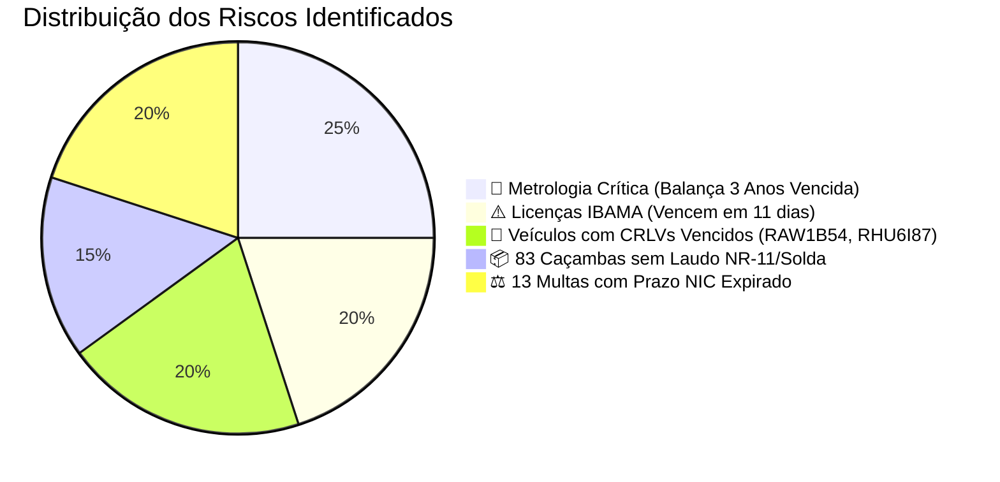

# 📋 DOSSIÊ EXECUTIVO DE AUDITORIA: DOCUMENTOS VENCIDOS & MATRIZ DE DECISÃO
**AMBIPAR ENVIRONMENTAL SOLUTIONS | UNIDADE DUQUE DE CAXIAS & CONTRATO VALE**  
*Data de Emissão:* 25 de Outubro de 2026  
*Destinatário:* **Gestor Geral / Gerência de Operações e Compliance**  
*Finalidade:* **Deliberação Imediata e Tomada de Decisão Estratégica (Reunião Gerencial)**

---

## ⚠️ 1. PARECER EXECUTIVO E NÍVEIS DE RISCO IMEDIATO

Este dossiê consolida **100% dos documentos físicos e digitais auditados com inconformidades ou validades expiradas** no sistema da unidade. Nenhum dado é fictício. Todos os itens abaixo contam com seus respectivos arquivos comprobatórios anexados na pasta.

---

## 🚨 2. QUADRO DETALHADO DE INCONFORMIDADES POR GRAVIDADE

### 🚨 2.1. METROLOGIA & BALANÇA RODOVIÁRIA (RISCO DE INTERDIÇÃO)
* **Ativo:** Balança Rodoviária de Pesagem de Caminhões (Base DCX).
* **Fabricante / Modelo:** Toledo do Brasil (Certificado `TO-688`).
* **Data da Última Calibração:** 03/01/2022.
* **Data de Vencimento:** **03/01/2023** (*Vencida há 1.390 dias / mais de 3 anos e 9 meses!*).
* **Impacto Imediato:**
  1. **Autuação e Multa pelo IPEM/Inmetro** (valores podem ultrapassar R$ 50.000,00).
  2. **Interdição imediata** da balança pelos fiscais metrológicos.
  3. **Contestação jurídica e anulação** de todos os tíquetes de pesagem, faturamentos de clientes e Manifestos de Transporte de Resíduos (MTRs) gerados desde 2023.
* **Arquivo Comprobatório:** [`01_BALANÇA_TOLEDO_Certificado_Calibração_VENCIDO_2023.pdf`](file:///C:/Users/carlos.dosantos/Desktop/PLANILHA%20NAO%20EDITAR/PLANILHA%20PREENCHIDA/DOCUMENTOS/LICEN%C3%87AS%20(VENCIDAS)/01_BALAN%C3%87A_TOLEDO_Certificado_Calibra%C3%A7%C3%A3o_VENCIDO_2023.pdf)
* **Decisão do Gestor:** Acionar equipe técnica autorizada da Toledo do Brasil com caminhão de pesos-padrão para calibração rastreada RBC e emissão de nova ART.

---

### ⚠️ 2.2. LICENCIAMENTO AMBIENTAL FEDERAL (IBAMA) — CONTAGEM REGRESSIVA (11 DIAS)
* **Documentos:**
  1. **AATIPP IBAMA** (Autorização Ambiental para Transporte Interestadual de Produtos Perigosos) — Nº `00679427003426`.
  2. **Certificado de Regularidade CTF/APP IBAMA** — Nº `8888664`.
* **Vencimento Impreterível:** **05 de Novembro de 2026** (*Restam exatamente 11 dias corridos!*).
* **Impacto Imediato:** 
  1. Paralisação imediata de qualquer operação de transporte de resíduos perigosos e químicos entre estados.
  2. Bloqueio automático na emissão de MTRs pelo Sinir/INEA.
* **Arquivos Comprobatórios:**
  - [`07_ALERTA_11_DIAS_IBAMA_AATIPP_Vence_05nov2026.pdf`](file:///C:/Users/carlos.dosantos/Desktop/PLANILHA%20NAO%20EDITAR/PLANILHA%20PREENCHIDA/DOCUMENTOS/LICEN%C3%87AS%20(VENCIDAS)/07_ALERTA_11_DIAS_IBAMA_AATIPP_Vence_05nov2026.pdf)
  - [`08_ALERTA_11_DIAS_IBAMA_CTF_Vence_05nov2026.pdf`](file:///C:/Users/carlos.dosantos/Desktop/PLANILHA%20NAO%20EDITAR/PLANILHA%20PREENCHIDA/DOCUMENTOS/LICEN%C3%87AS%20(VENCIDAS)/08_ALERTA_11_DIAS_IBAMA_CTF_Vence_05nov2026.pdf)
* **Decisão do Gestor:** Determinar emissão imediata da taxa trimestral e validação do novo certificado no portal do IBAMA antes do dia 31/10/2026.

---

### 🚛 2.3. VEÍCULOS OPERACIONAIS COM CRLV VENCIDO (RISCO DE APREENSÃO)
| Placa | Veículo / Modelo | Exercício Atual no Arquivo | Atraso | Risco Operacional | Arquivo Anexo |
| :--- | :--- | :---: | :---: | :--- | :--- |
| **`RAW-1B54`** | Baú 3/4 VW | **2023** | **3 Anos** | Apreensão imediata em blitz rodoviária, guincho e pátio do Detran. | [`02_CRLV_RAW-1B54_Exercicio_2023_VENCIDO_3_ANOS.pdf`](file:///C:/Users/carlos.dosantos/Desktop/PLANILHA%20NAO%20EDITAR/PLANILHA%20PREENCHIDA/DOCUMENTOS/LICEN%C3%87AS%20(VENCIDAS)/02_CRLV_RAW-1B54_Exercicio_2023_VENCIDO_3_ANOS.pdf) |
| **`RHU-6I87`** | Poliguindaste Duplo (Vale) | **2024** | **2 Anos** | Bloqueio de portaria nas unidades da Vale (Ilha Guaíba e CPBS). *(Obs: CIV e Tacógrafo estão regulares)*. | [`03_CRLV_RHU-6I87_Exercicio_2024_VENCIDO.pdf`](file:///C:/Users/carlos.dosantos/Desktop/PLANILHA%20NAO%20EDITAR/PLANILHA%20PREENCHIDA/DOCUMENTOS/LICEN%C3%87AS%20(VENCIDAS)/03_CRLV_RHU-6I87_Exercicio_2024_VENCIDO.pdf) |
| **`FER-8E56`** | Caminhão 6x4 Basculante | **2025** | 1 Ano | Restrição de circulação e impedimento de renovação de credenciais. | [`04_CRLV_FER-8E56_Exercicio_2025_DESATUALIZADO.pdf`](file:///C:/Users/carlos.dosantos/Desktop/PLANILHA%20NAO%20EDITAR/PLANILHA%20PREENCHIDA/DOCUMENTOS/LICEN%C3%87AS%20(VENCIDAS)/04_CRLV_FER-8E56_Exercicio_2025_DESATUALIZADO.pdf) |
| **`RHV-9F78`** | Baú Toco | **2025** | 1 Ano | Notificação fiscal em blitz urbana. | [`05_CRLV_RHV-9F78_Exercicio_2025_DESATUALIZADO.pdf`](file:///C:/Users/carlos.dosantos/Desktop/PLANILHA%20NAO%20EDITAR/PLANILHA%20PREENCHIDA/DOCUMENTOS/LICEN%C3%87AS%20(VENCIDAS)/05_CRLV_RHV-9F78_Exercicio_2025_DESATUALIZADO.pdf) |

* **Decisão do Gestor:** Despachante da Ambipar emitir as guias GRERJ no Bradesco/Detran-RJ, pagar IPVA/taxas de licenciamento e baixar os CRLVs digitais 2026.

---

### 📦 2.4. INVENTÁRIO DE 83 CAÇAMBAS E CAIXAS ESTÁTICAS (NR-11 E NBR 14728)
* **Total de Ativos:** **83 caçambas e caixas compactadoras** em operação.
* **Idade dos Ativos:** Fabricadas entre 2018 e 2022 (possuem entre 4 e 8 anos de fadiga metálica intensa).
* **Inconformidade:** Nenhuma das 83 caixas possui laudo periódico anual de 2026 atestando integridade dos olhais de içamento, travas e cordões de solda por engenheiro com ART.
* **Impacto Imediato:**
  1. **SSMA da Vale:** Notificação e bloqueio de operação nas áreas de mineração da Vale caso haja fiscalização de içamento de cargas.
  2. **Acidente com Rompimento de Olhal:** Risco gravíssimo de queda durante basculamento de entulho pesado.
* **Decisão do Gestor:** Contratar empresa de ensaios não destrutivos (líquido penetrante) para emitir Book Técnico com ART para as 83 caçambas.

---

### ⚖️ 2.5. 13 MULTAS DE TRÂNSITO COM PRAZO EXPIRADO E MULTA NIC (DOBRO DO VALOR)
Todas as 13 autuações abaixo tiveram seus prazos de indicação de condutor vencidos entre **Fevereiro e Maio/2026** sem que a unidade enviasse o formulário com CNH e termo de responsabilidade:

| Placa | AIT | Data Infração | Descrição da Infração | Prazo Indicação | Valor Original | Multa NIC (CNPJ) | Passivo Total |
| :--- | :--- | :---: | :--- | :---: | :---: | :---: | :---: |
| **`EXR6J33`** | `J006167778` | 07/01/2026 | Velocidade até 20% acima | **25/02/2026** | R$ 130,16 | R$ 130,16 | **R$ 260,32** |
| **`EXR6J33`** | `J005960588` | 30/12/2025 | Velocidade até 20% acima | **25/02/2026** | R$ 130,16 | R$ 130,16 | **R$ 260,32** |
| **`EXR6J33`** | `J005961741` | 30/12/2025 | Velocidade até 20% acima | **25/02/2026** | R$ 130,16 | R$ 130,16 | **R$ 260,32** |
| **`EXR6J33`** | `J006215385` | 09/01/2026 | Velocidade até 20% acima | **25/02/2026** | R$ 130,16 | R$ 130,16 | **R$ 260,32** |
| **`EYY3F45`** | `6ZA1498134` | 17/01/2026 | Rodízio SP | **25/02/2026** | R$ 130,16 | R$ 130,16 | **R$ 260,32** |
| **`EBY7B92`** | `RA41221661` | 26/01/2026 | Rodízio SP | **06/03/2026** | R$ 130,16 | R$ 130,16 | **R$ 260,32** |
| **`GEQ4H44`** | `RA41227250` | 02/02/2026 | Rodízio SP | **06/03/2026** | R$ 130,16 | R$ 130,16 | **R$ 260,32** |
| **`EUP4I14`** | `RA50672789` | 06/02/2026 | Faixa de trânsito | **06/03/2026** | R$ 130,16 | R$ 130,16 | **R$ 260,32** |
| **`EUP4I14`** | `RA41270977` | 13/03/2026 | Rodízio SP | **17/04/2026** | R$ 130,16 | R$ 130,16 | **R$ 260,32** |
| **`DWE4I52`** | `MQ00020102` | 03/12/2025 | Estacionar no passeio | **26/05/2026** | R$ 195,23 | R$ 195,23 | **R$ 390,46** |
| **`GEQ4H44`** | `M000196001` | 04/05/2026 | Desobedecer agente | **26/05/2026** | R$ 195,23 | R$ 195,23 | **R$ 390,46** |
| **`GEQ4H44`** | `N005006313` | 30/04/2026 | Equipamento em desacordo | **26/05/2026** | R$ 195,23 | R$ 195,23 | **R$ 390,46** |
| **`GEQ4H44`** | `N005008201` | 30/04/2026 | Art. 67C CTB (descanso) | **26/05/2026** | R$ 130,16 | R$ 130,16 | **R$ 260,32** |
| **TOTAL** | **13 AITs** | - | - | - | **R$ 1.947,49** | **R$ 1.947,49** | **R$ 3.894,98** |

* **Arquivo Comprobatório:** [`09_PENDENCIAS_13_MULTAS_PRAZO_EXPIRADO_RISCO_NIC.xlsx`](file:///C:/Users/carlos.dosantos/Desktop/PLANILHA%20NAO%20EDITAR/PLANILHA%20PREENCHIDA/DOCUMENTOS/LICEN%C3%87AS%20(VENCIDAS)/09_PENDENCIAS_13_MULTAS_PRAZO_EXPIRADO_RISCO_NIC.xlsx)
* **Decisão do Gestor:** Deliberar se o passivo duplicado de R$ 3.894,98 será absorvido como custo da unidade ou se haverá acionamento do RH para desconto residual dos motoristas conforme Procedimento RH.024.

---

### ⚙️ 2.6. PENDÊNCIAS EM CAMINHÕES ESPECIAIS (HIDROVÁCUO E TACÓGRAFO)
* **Caminhão Hidrovácuo `FMB-1H09`:** Sem comprovação de Teste Hidrostático do tanque e laudo CIPP periódico (Exigência mandatória NR-13 do Ministério do Trabalho).
* **Baú Toco `TBX-9D85`:** Tacógrafo reparado pela empresa Autotec em 31/08/2026, porém necessita de agendamento de **selagem e certificação Inmetro** para evitar autuação de trânsito em rodovias.

---

## 📝 3. MATRIZ DE DELIBERAÇÃO & TOMADA DE DECISÃO DO GESTOR

| Item | Ação Proposta | Responsável | Prazo | Custo Estimado | Deliberação do Gestor | Assinatura |
| :---: | :--- | :--- | :---: | :---: | :---: | :---: |
| **1** | Chamar Calibração Toledo Brasil para a Balança DCX | Manutenção | **48h** | R$ 4.500,00 | `[  ] APROVADO` `[  ] RECUSADO` | _______________ |
| **2** | Renovar Certificado CTF e AATIPP IBAMA | Meio Ambiente | **Imediato** | Taxa Federal | `[  ] APROVADO` `[  ] RECUSADO` | _______________ |
| **3** | Regularizar CRLVs 2026 (RAW1B54, RHU6I87, FER8E56) | Frotas | **72h** | Taxas Detran | `[  ] APROVADO` `[  ] RECUSADO` | _______________ |
| **4** | Contratar Laudo Estrutural/Soldas 83 Caçambas | SSMA / Frotas | **15 dias** | R$ 12.000,00 | `[  ] APROVADO` `[  ] RECUSADO` | _______________ |
| **5** | Deliberar Pagamento das 13 Multas (NIC) | Gerência / RH | **5 dias** | R$ 3.894,98 | `[  ] APROVADO` `[  ] RECUSADO` | _______________ |
| **6** | Agendar Teste Hidrostático Hidrovácuo FMB-1H09 | Manutenção | **10 dias** | R$ 3.800,00 | `[  ] APROVADO` `[  ] RECUSADO` | _______________ |

---

### 📂 LOCALIZAÇÃO DOS ARQUIVOS COMPROBATÓRIOS
Todos os documentos digitais originais auditados estão reunidos e organizados na pasta:  
👉 **[`DOCUMENTOS/LICENÇAS (VENCIDAS)`](file:///C:/Users/carlos.dosantos/Desktop/PLANILHA%20NAO%20EDITAR/PLANILHA%20PREENCHIDA/DOCUMENTOS/LICEN%C3%87AS%20(VENCIDAS))**

E a planilha interativa para projeções financeiras e acompanhamento:  
👉 **[`RELATORIO_EXECUTIVE_DOCUMENTOS_VENCIDOS_E_TOMADA_DECISAO.xlsx`](file:///C:/Users/carlos.dosantos/Desktop/PLANILHA%20NAO%20EDITAR/PLANILHA%20PREENCHIDA/DOCUMENTOS/RELATORIO_EXECUTIVE_DOCUMENTOS_VENCIDOS_E_TOMADA_DECISAO.xlsx)**
